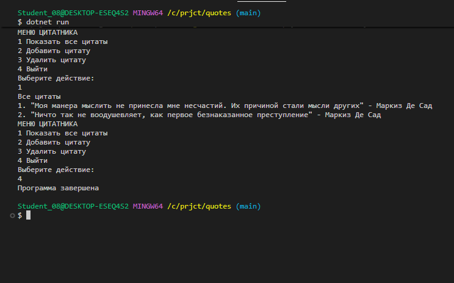
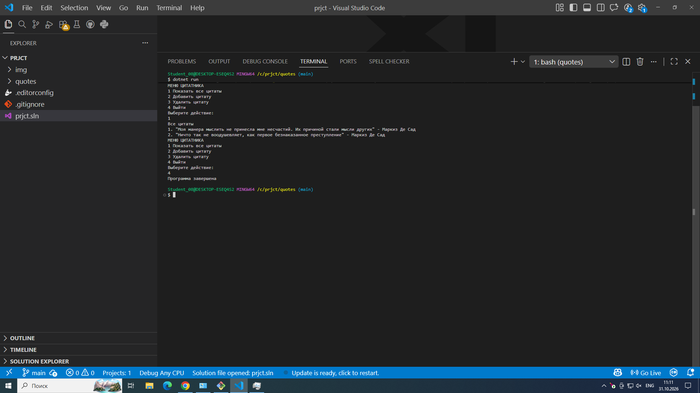

# QUOTEMANAGER APP


**Автор:** Чумаченко Михаил
**Группа:** ИСП-242


___


Простой консольный проект на языке **C#**, позволяющий управлять коллекцией цитат (просматривать, добавлять новые и удалять существующие).

## Возможности

 **Просмотр всех цитат**: вывод списка цитат с указанием авторов и порядковых номеров.
 **Добавление цитат**: сохранение новых цитат в удобном строковом формате.
 **Удаление цитат**: удаление записи по её порядковому номеру.
 **Простое меню**: интуитивно понятное управление через консольный интерфейс.

---

## Требования

- **.NET SDK** (версии .NET Core / .NET 5 / .NET 6 / .NET 7 / .NET 8 или новее).

---

## Как запустить проект

1. Клонируйте репозиторий или скачайте исходный код:
   ```bash
   git clone < url >
   ```
2. Перейдите в папку с проектом:
   ```bash
   cd quotes
   ```
3. Запустите приложение с помощью команды:
   ```bash
   dotnet run
   ```

---

## Как пользоваться

При запуске программы откроется главное меню с выбором действий:

1. **Показать все цитаты** — выводит список всех сохранённых цитат.
2. **Добавить цитату** — запросит ввод в специальном формате:
   ```text
   Текст цитаты @ Автор
   ```
   _Пример:_
   ```text
   Моя манера мыслить не принесла мне несчастий. Их причиной стали мысли других @ Маркиз Де Сад
   ```
3. **Удалить цитату** — выведет список цитат и попросит ввести номер той, которую нужно удалить.
4. **Выйти** — завершение работы приложения.

---

## Пример структуры кода

Программа строится вокруг класса `QuoteManager` (реализующего логику хранения и обработки списка цитат) и управляющего цикла в методе `Main`.




